# vATMS - virtual Air Traffic Management System

A basic simulation of the interim Future Area Control Tools (iFACTS) used in the London Area Control Centre.

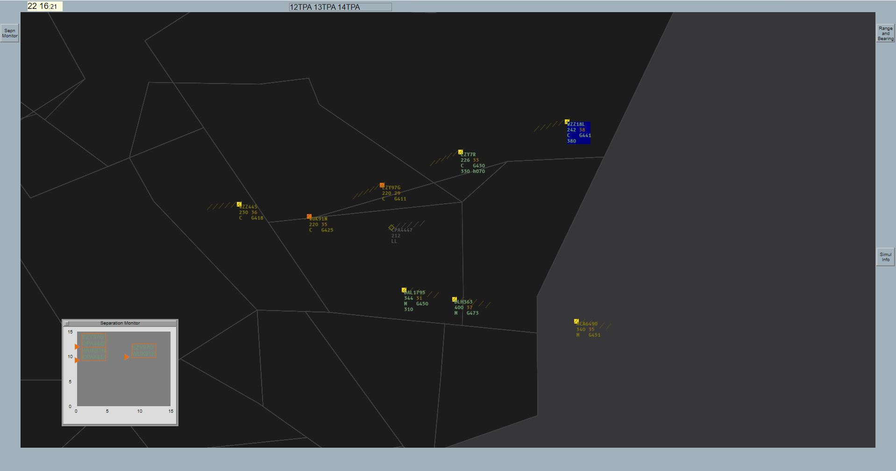

## Running/building from the CLI

### Requirements
- .NET 8 or later
- NodeJS v22 or later

### Setup

Install the following NuGet packages

```bash
dotnet add package ElectronNET.Core
dotnet add package ElectronNET.Core.AspNet
dotnet add package Newtonsoft.Json
```
To run the program, run the following command in the base directory or the `/vATMS.Server` directory
```bash
electronize start
```
The required npm packages should install automatically on the first build/run. If they do not install automatically, run the following command in the `/vatms.client` directory
```bash
npm i
```
To build and package the program for Windows, run the following command in the base directory or the `/vATMS.Server` directory
```bash
electronize build /target win
```
> Builds for other platforms have not been tested

## The simulator
### Keybinds

| Key | Action |
| --- | --- |
| <kbd>→</kbd> | Pan right
| <kbd>←</kbd> | Pan left
| <kbd>↑</kbd> | Pan up
| <kbd>↓</kbd> | Pan down
| <kbd>=</kbd> | Decrease range (zoom in)
| <kbd>-</kbd> | Increase range (zoom out)
| <kbd>R</kbd> | Toggle route draw

### Datablocks
#### Layout
```
{Callsign}
{Current Level} {Transfer/requested Level}
{Intention code} {Ground speed}
{Cleared Level (if not reached)} {Heading/Direct (if assigned)}
```
#### Symbology
Assumed (in your sector, controllable) aircraft have a light green datablock

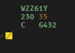

Concerned (will enter your sector next, not controllable yet) aircraft have a yellow datablock

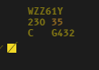

Redundant (has left your sector after fufilling a standing agreement, not controllable) aircraft have a dark green datablock

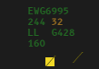

Unconcerned (will not enter your sector, not controllable) aircraft have a grey datablock

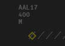

Selected datablocks will have a blue background
> Note that the background is not dynamically sized. This is a feature of the real system.

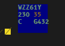

Aircraft in short-term conflict will have a red datablock and target

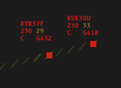

Aircraft in medium-term conflict (a potential conflict predicted within the next 15 minutes) will have an orange target

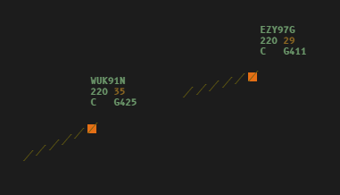

### iFACTS HMI

#### Selection window
The selection window displays
- information about the selected aircraft, in the top bar
- information about aircraft in the sector ("Incomm") and about to enter the sector ("Pending"), and allows them to be selected, in scrollable bays below the top bar and the heading/direct select
  
and allows the user to select the selected aircraft's 
- cleared level, using the vertical scroll menu on the left
- heading and direct point, using the horizontal scroll menu above the scrollable bays
- cleared speed, by clicking on the speed section of the top bar
    - to resume normal speed, simply press <kbd>Enter</kbd> after opening the speed window without typing anything
    - to leave the speed selection without entering anything, press <kbd>Esc</kbd>

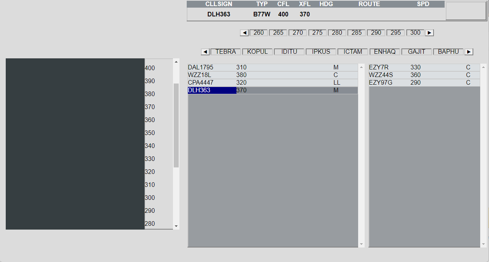

#### Separation monitor
The separation monitor displays medium term conflicts pairs up to 15 minutes in advance, in which at least one aircraft is currently in or will enter the user sector within the next 15 minutes.

The vertical axis is sorted by distance when the conflict begins, and the horizonal axis is sorted by time. The closer to the left and bottom of the window a conflict pair is, the more urgent and severe the conflict is.

The separation monitor can be toggled by clicking the "Sepn Monitor" button on the virtual frame of the radar screen.

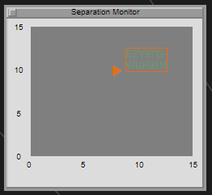

#### Range and bearing line
The range and bearing line allows the user to measure the distance and bearing between two points on the radar screen.

The 1st click places the first point, and a 2nd click places the 2nd point. To remove the line, click again. 

The range and bearing line can be toggled by clicking the "Range and Bearing" button on the virtual frame of the radar screen.

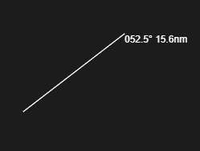

#### Route draw 

The route draw displays the predicted route of the aircraft in the next 15 minutes, with labels for waypoints and timestamps. 

Route draw can be toggled by pressing <kbd>R</kbd>

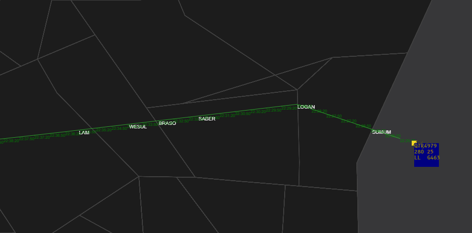

### Gameplay

> Only the Clacton Bandbox sector has any meaningful amount of traffic, as there are currently only a limited selection of routes defined for testing purposes

The main objective/complexity of the project is in the conflict detection and other algorithmic components, and thus gameplay is not fully fleshed out and is slightly dull.

There is no formal "level" system, however the main objectives are:
- To not have any short term conflict alerts (less than 5 nautical miles/1000ft of separation)
- To allow aircraft to achieve their requested flight level
- To hand off to the next sector in accordance to the standing agreement, if one exists

In other words, try and make the plane reach the orange level on its datablock without crashing (losing separation) into another plane. 

To do this, the user may assign:
- an cleared level 
- a heading/direct 
- a indicated airspeed/mach number

If the aircraft is unable to follow the instrcution (e.g. climbing above their ceiling altitude), it will attempt to do the best it can and will stop once it is impossible to achieve.

Once an aircraft has satisfied a standing agreement, it will attempt to leave the sector (e.g. by descending) into the next sector.
> The only standing agreements currently implemented is FL250 level by LOGAN; FL260 level by EVTAX; FL220 level by HEMEL 

Gameplay stats may be obtained by clicking the "Simul Info" button on the virtual frame of the radar screen. The spawn rate may also be adjusted in the same window.

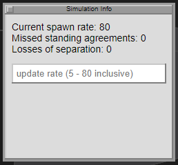

Some knowledge of air traffic management is required to use the simulator effectively. Sector and agreed level diagrams may be obtained at 
[VATSIM UK](https://docs.vatsim.uk/Enroute/London%20FIR%20%28EGTT%29/1-ALD/).


